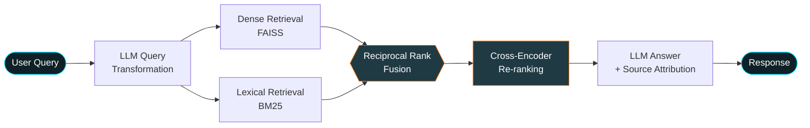

<!-- ===================== HEADER ===================== -->
<div align="center">


<a href="https://git.io/typing-svg">
  
</a>

<br/>

[](https://www.linkedin.com/in/harshil-solanki-ai26)
[](mailto:harshilsolanki2610@gmail.com)
[](https://github.com/26harshil)


</div>

---

## 👨‍💻 About Me

```python
class HarshilSolanki:
    role       = "AI/ML Engineer (GenAI & Agentic Systems)"
    education  = "B.Tech CSE @ Darshan University (2023-2027) | CGPA 8.71/10"
    focus      = ["Multi-Agent Orchestration", "Hybrid RAG", "LLM Fine-Tuning", "Full-Stack AI Apps"]
    principles = ["Deterministic guardrails", "Low-latency streaming", "Type-safe interfaces"]
    open_to    = "AI Engineer / GenAI Engineer roles & internships"

    def mission(self):
        return "Turn complex LLM pipelines into reliable, production-grade products."
```

- 🧠 **AI/ML & GenAI:** End-to-end LLM applications, **LangGraph multi-agent workflows**, **Corrective / Self-RAG**, **Hybrid Search (Dense + BM25 + RRF)**, **LoRA / QLoRA** fine-tuning.
- ⚡ **Full-Stack Execution:** Bridging AI inference pipelines with clean **Next.js**, **FastAPI** and **Flutter** interfaces.
- 🛡️ **Engineering Rigor:** AST-validated code execution, Docker sandboxing, read-only SQL enforcement, streaming architectures.

---

## 🛠️ Tech Arsenal

<div align="center">

### 🤖 AI / GenAI / ML


### 🌐 Full-Stack, Data & Cloud


</div>

<details>
<summary><b>📋 Detailed Skill Breakdown</b></summary>
<br>

| Area | Skills |
| :--- | :--- |
| **LLM & Agentic Workflows** | LangGraph, LangChain, Model Context Protocol (MCP), Autonomous Tool Calling, Multi-Agent Routing |
| **Advanced RAG & Search** | Hybrid Search (FAISS + BM25), Reciprocal Rank Fusion (RRF), Cross-Encoder Re-ranking, Corrective RAG (CRAG), Self-RAG |
| **Training & Optimization** | LoRA / QLoRA Fine-Tuning, Custom GRU / Transformer Architectures, Tokenization & NLP Pipelines |
| **Vector Databases** | Pinecone, ChromaDB, FAISS |
| **Backend** | FastAPI, NestJS, Node.js, .NET Core |
| **Frontend / Mobile** | Next.js, React, TypeScript, Flutter |
| **Data & DevOps** | PostgreSQL, MongoDB, Prisma, Docker, AWS |

</details>

---

## 🏆 Featured AI Projects

<table>
<tr>
<td width="50%" valign="top">

### 🤖 [SQL-AGENT](https://github.com/26harshil/SQL-AGENT)
**Autonomous Data Analysis & ETL Multi-Agent Framework**


- Hierarchical **multi-agent system** routing queries between an **NL-to-SQL analyst** and a **ReAct ETL agent**
- Dynamic **schema introspection** + grounded SQL generation
- **`sqlglot` AST validation** (read-only SQL) + **Python AST inspection** + **isolated Docker sandbox** for LLM-generated Pandas code

</td>
<td width="50%" valign="top">

### 🔍 [Multi-Utility Agent (chat-with-pdf)](https://github.com/26harshil/chat-with-pdf)
**4-Stage Hybrid RAG & Agentic Assistant**


- Stateful LangGraph agent with **SQLite checkpointing** & multi-turn memory
- Tools: PDF retrieval, live web search, calculator
- **FAISS + BM25 → RRF → Cross-Encoder** re-ranking, with LLM query transformation and source attribution

</td>
</tr>
<tr>
<td width="50%" valign="top">

### ✍️ [Blog-writing-Agent](https://github.com/26harshil/Blog-writing-Agent)
**Autonomous Multi-Agent Content Engine**


- Collaborative agent pipeline: **research → outline → draft → SEO refinement**
- Full-stack workspace with a FastAPI backend and Next.js UI

</td>
<td width="50%" valign="top">

### 🧠 Next-Word Language Model
**Deep GRU Neural Architecture (from scratch)**


- Multi-layer **GRU** trained on **2.7M+ tokens** of WikiText-103
- Stabilized with **dynamic gradient clipping**; **temperature-controlled sampling** for generation

</td>
</tr>
</table>

### 🧩 Architecture Spotlight: 4-Stage Hybrid RAG



---

## 💻 Applied ML & Full-Stack Systems

| Project | Domain | Stack | Highlights |
| :--- | :--- | :--- | :--- |
| 🎥 **[Bot-buddy (MeetAI)](https://github.com/26harshil/Bot-buddy)** | Full-Stack AI | `Next.js` `TypeScript` `Stream` `Better Auth` | Real-time AI meeting platform with video/chat and autonomous agent workflows |
| 🎓 **[Projexia](https://github.com/26harshil/Projexia)** | Full-Stack Web | `Next.js` `Prisma` `PostgreSQL` `Clerk` `Stream` | Student project management with RBAC, real-time messaging, lifecycle tracking |
| 👤 **[Age-Gender-Predictors](https://github.com/26harshil/Age-Gender-predictors)** | Computer Vision | `FastAPI` `PyTorch` `OpenCV` `Next.js` | Deep learning inference API with an interactive Next.js client |
| ❤️ **[Cardio Risk Engine](https://github.com/26harshil/cardio-backend)** | Healthcare ML | `FastAPI` `Scikit-learn` `Next.js` | End-to-end cardiovascular risk prediction ([Backend](https://github.com/26harshil/cardio-backend) · [Frontend](https://github.com/26harshil/cardio-frontend)) |
| 😷 **[Mask Detection API](https://github.com/26harshil/model)** | Computer Vision | `PyTorch` `FastAPI` `Torchvision` | Real-time face-mask object detection server |
| 🎬 **[Movie_r](https://github.com/26harshil/Movie_r)** | Recommender | `FastAPI` `Pandas` `Next.js` | Content-based recommendation engine served over REST |

<details>
<summary><b>📱 Mobile (Flutter), Backend & Foundation Repositories</b></summary>
<br>

**Mobile & Cross-Platform**
- **[nextgen_learners](https://github.com/26harshil/nextgen_learners)**: Flutter e-learning app with GetX state management, TTS and REST APIs
- **[amzon](https://github.com/26harshil/amzon)**: Flutter e-commerce app with payments and analytics charts

**Backend Services**
- **[Ticket_managament](https://github.com/26harshil/Ticket_managament)**: NestJS + TypeScript service with PostgreSQL and JWT auth
- **[nextgen_learners_backend](https://github.com/26harshil/nextgen_learners_backend)**: .NET Core API (EF Core + Npgsql) for quiz and learning content

**Core CS & Coursework**
- **[Sem---3--DATA-STRUCTURE](https://github.com/26harshil/Sem---3--DATA-STRUCTURE)**: DSA implementations in Java
- **[DBMS-2](https://github.com/26harshil/DBMS-2)**: Advanced SQL and MongoDB aggregation labs
- **[python](https://github.com/26harshil/python)**: Python scripting and data analysis notebooks

</details>

---

## 📜 Certifications

| Certification | Issuer |
| :--- | :--- |
| 🔗 Foundation: Introduction to LangChain | LangChain Academy |
| 🌐 Responsive Web Design | freeCodeCamp |

---

## 📊 GitHub Stats

<div align="center">


</div>

---

<div align="center">

### 🤝 Let's Build Something Impactful

I'm open to **AI Engineer / GenAI Engineer** opportunities. Let's talk agents, RAG and production AI.

[](mailto:harshilsolanki2610@gmail.com)
[](https://www.linkedin.com/in/harshil-solanki-ai26)


</div>
